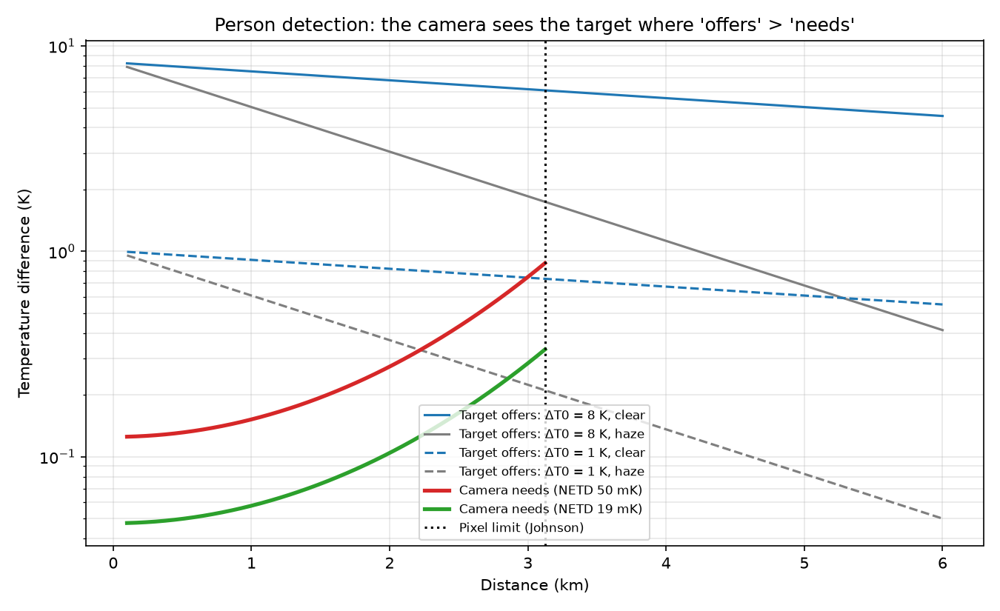
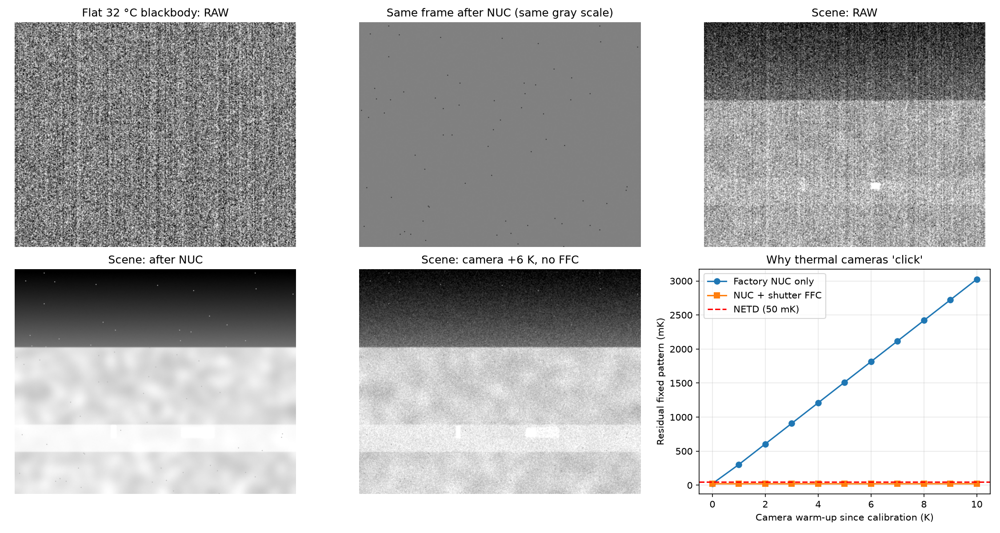
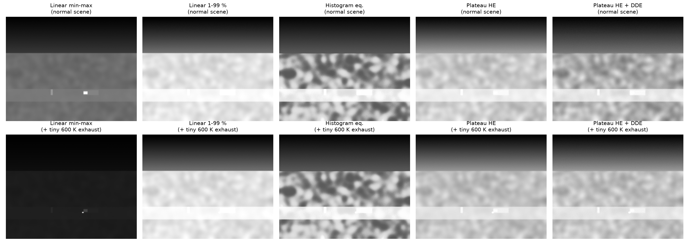
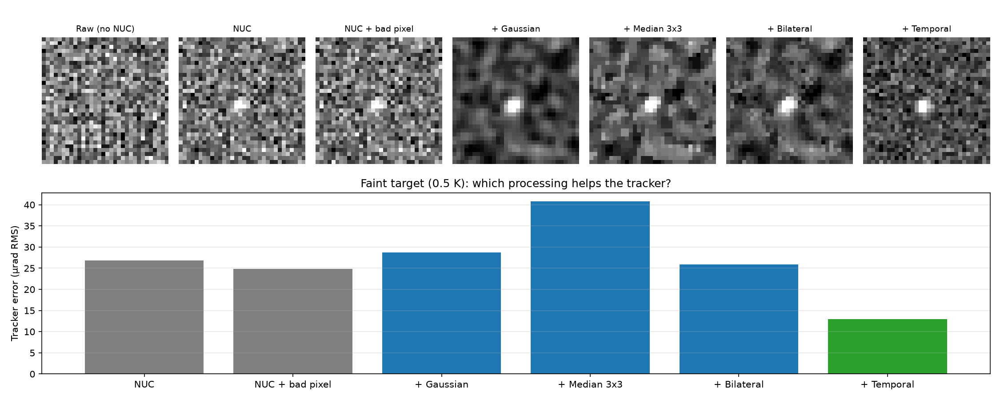
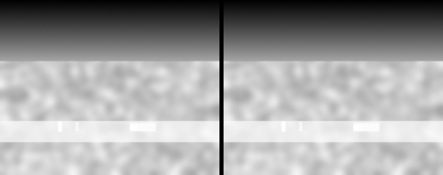

# thermal-pipeline


A physics-based **LWIR microbolometer camera simulator** and a complete **thermal image
processing pipeline** (NUC → bad pixels → filtering → AGC), validated against my own
simulations and real FLIR ADAS raw 16-bit data, plus a **range performance model**.

Written in Python (NumPy/SciPy), packaged, tested with pytest (51 tests) and checked by CI.

```
scene (K) → Planck radiance → atmosphere → optics (blur) → microbolometer (FPN, noise, drift, 14-bit)
         → two-point NUC + shutter FFC → bad pixel replacement → temporal filter → AGC (plateau HE) → 8-bit display
```

## Key results

| Topic | Result |
|---|---|
| LWIR vs MWIR at 300 K | 54.9 vs 1.87 W/m²/sr; contrast 1.53 %/K vs 3.63 %/K |
| Detector NETD | 50 mK designed, **50.4 mK** measured in simulation, **≈42 mK** on real FLIR data |
| Non-uniformity correction | Fixed pattern 342 → **0.70 counts (17 mK)**, 68/68 bad pixels found (MAD) |
| Shutter FFC | After a +6 K camera temperature drift: 1815 mK error → **20 mK** |
| Sub-pixel tracker (noise) | raw: lost · NUC: 26.8 µrad · + temporal filter: **13.0 µrad** |
| Display | Plateau histogram equalization: robust to a 600 K exhaust hot spot |
| Speed | 256×320 pipeline at **~296 FPS** (bad pixel step 30.6 → 0.7 ms after profiling) |
| Range (person, 0.75 m) | Detection 3.1 km · recognition 0.78 km · identification 0.49 km (Johnson) |

## Highlights

**Physics.** Band-integrated Planck radiance with a lookup table, Beer–Lambert atmosphere with path
radiance, camera equation `E = τπL / (1 + 4F²)`, diffraction + aberration blur and MTF.

**Detector.** Gain/offset fixed pattern noise, column stripes, dead/hot pixels, drift with focal plane
temperature, 1/f noise, bolometer thermal time constant, 14-bit ADC.

**Processing.** Two-point NUC, shutter-based offset update (FFC), robust bad pixel detection and
replacement, Gaussian/median/bilateral/temporal filters, min-max / percentile / histogram / plateau
equalization / DDE display, profiled `ThermalPipeline` with per-stage timing.

**Lessons that surprised me**
- Spatial smoothing *hurts* a matched-filter tracker (the template already averages noise); the temporal
  filter helps static targets but leaves a lag trail on moving ones, `lag = (1 − α) / α` frames.
- Range is limited either by **pixels** or by **contrast**. On a normal day (ΔT = 8 K) a 300 mm lens triples
  the detection range and noise filtering changes nothing; at thermal crossover (ΔT = 1 K) in haze the
  temporal filter helps (2.2 → 2.9 km) and the lens gain shrinks.



| | |
|---|---|
|  |  |
|  |  |

## Real data (FLIR ADAS v2)

`tools/fetch_flir_samples.py` reads single files out of the 11.9 GB split-zip dataset with HTTP range
requests (≈82 MB downloaded instead of 12 GB). The raw 16-bit "T-linear" data were found to use
**0.04 K per count**, and the measured temporal noise matched the simulated detector.

The dataset is **not** included in this repository. Download it yourself after accepting the terms at
[FLIR ADAS dataset](https://www.flir.com/oem/adas/adas-dataset-agree/), then run
`python tools/fetch_flir_samples.py --get 20` and `python experiments/exp08_real_data.py`.

## Run it

```bash
python -m pip install -e ".[dev]"
python -m pytest                     # 51 tests
python experiments/exp01_physics.py  # ... up to exp09_range.py, figures go to results/
```

## Project layout

```
src/thermalpipe/   physics, scene, optics, detector, nuc, filters, tracker, agc, pipeline, metrics, datasets
tests/             pytest suite (physics checks, reference implementations, fake HTTP server)
experiments/       exp01 … exp09, one question each
tools/             FLIR sample downloader
```

## Limitations

- The scene is synthetic and simple (boxes with texture); no real atmosphere model (MODTRAN), single extinction value.
- The range model is MRTD-like with an assumed SNR threshold of 2.5; real models (NVThermIP / TRM4) also
  include the eye and the display.
- DDE is too slow in pure Python (631 ms at 640×512); a real camera does this in FPGA.

Part of my roadmap toward electro-optics / thermal imaging engineering.
Previous project: [gimbal-stabilization](https://github.com/SirPicklee/gimbal).